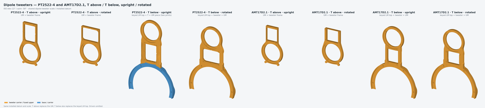

# Dipole tweeters — GRS PT2522-4 and Mundorf AMT17D2.1

Obiwan only. One open-back tweeter radiates front and rear (dipole), mounted on a printed frame next to the raised
MU10. Each driver comes in four layouts: **T above** or **T below** the MU10, **upright** or **rotated** 90°.
Status: candidate. Digital geometry, duct and slicer checks pass; nothing has been printed or measured yet.

All eight layouts at one scale and installed datum. Gold is the dipole part. The PT2522-4 upright T below is two prints:
the keyed LM top variant (blue) and the T + UM piece. Drivers are omitted.

## What to print (per speaker)

Shelf folder: [`to_print/obiwan/dipole/`](../to_print/obiwan/dipole/). `<driver>` is `pt2522` or `amt17d2`.

| Layout | Dipole part(s) | Plus, from the regular Obiwan shelf |
|---|---|---|
| T above, upright / rotated | `obiwan_<driver>_t_above_<upright\|rotated>` — the UM and tweeter frame in one piece | Any Obiwan LM: the one-piece LM carrier, or the keyed bottom + keyed top (either stand state) |
| T below, AMT17D2.1 upright / rotated; PT2522-4 rotated | `obiwan_<driver>_t_below_<orientation>` — keyed LM top, tweeter frame and UM in one piece | The keyed LM bottom for your stand state |
| T below, PT2522-4 upright | `obiwan_pt2522_t_below_upright_lm_top` + `obiwan_pt2522_t_below_upright_um_t` — two prints (one piece would exceed the H2C nozzle reach), joined at the regular LM–UM joint with its M2 tie | The keyed LM bottom for your stand state |

The dipole parts take **no wings** (T below fills the keyed top's wing-magnet pockets). They replace the regular UM
carrier and crescent; T below also replaces the keyed LM top. The floor-stand NL8 service lid still applies.

In the combined Obiwan plate files these are options **E** (T above) and **F** (T below); option E shares the LM
carrier plate with A–C, option F the keyed LM bottom plate with D.

## Hardware

- **Driver:** 4 × M3 screws into 4 × M3 heat-set inserts (the project's standard Hanglife M3 × 5 × 4, D4.6 × 4.0
  bores), on every layout. Screw length: driver flange thickness + 4 mm.
- **LM–UM tie (PT2522-4 upright pair):** the regular M2 tie, driven through the tweeter window with the driver out.

## Cables

Every lead runs in a hidden duct from the LM's own ducts:
- **UM (MU10) cable:** stays on +x and ends radially in the MU10's open back. It uses the UM's D8.2 duct, or a flat
  11.6 × 5.0 mm duct of the same section where the PT2522-4's 7 mm frame is too thin.
- **T cable:** reaches the driver's terminals or lead channel. T below keeps it on the −x side, so each side carries
  one duct and the frame stays narrow. T above branches it off the UM's own T lumen.
- **Section changes are gradual, never a step:** an inner corner would catch the cable when fishing it. The AMT's
  D4 T duct starts at the lumen's own D6 and narrows over 15 mm; the UM duct blends from round D8.2 to its flat
  section over 12–23 mm. Both blends follow a smoothstep curve.
- **Bends:** at least R14. The only owner-approved exception, R10 on the AMT upright UM guide, applied to the
  retired split part; every shipped duct is R15.8 or more.

## Printing

PETG-GF with PLA support interface on nozzle 2, front face down, support blockers in every duct (audited: no support
bead inside a duct). The two long T-below parts (AMT17D2.1 upright, PT2522-4 rotated, about 315 mm) print lengthwise
along Y **without a brim**: it is the only H2C layout where both nozzles reach every support.

## Sources

- Geometry: `src/lx521_baffle/obiwan/dipole_tweeter.py` (driver tables, frames, T above) and `lm_um_t.py` (T below, one
  piece and pair).
- Routes: `dipole_tweeter_routes.json` (T above), `dipole_tweeter_lm_routes.json` (T below, one piece),
  `dipole_tweeter_pair_routes.json` (PT2522-4 upright pair).
- Build: `scripts/build_dipole_tweeter.py`. Approved meshes, print authorities and blockers:
  [`candidates/dipole_tweeter/`](../candidates/dipole_tweeter/README.md).
